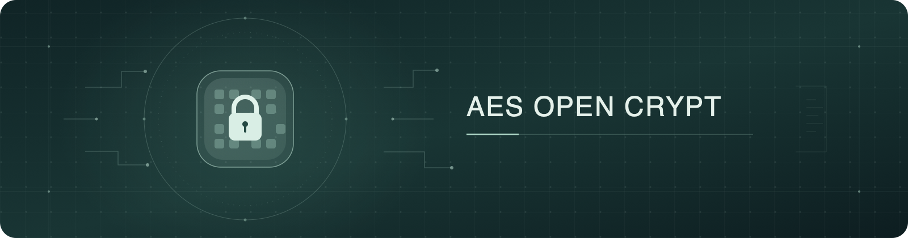
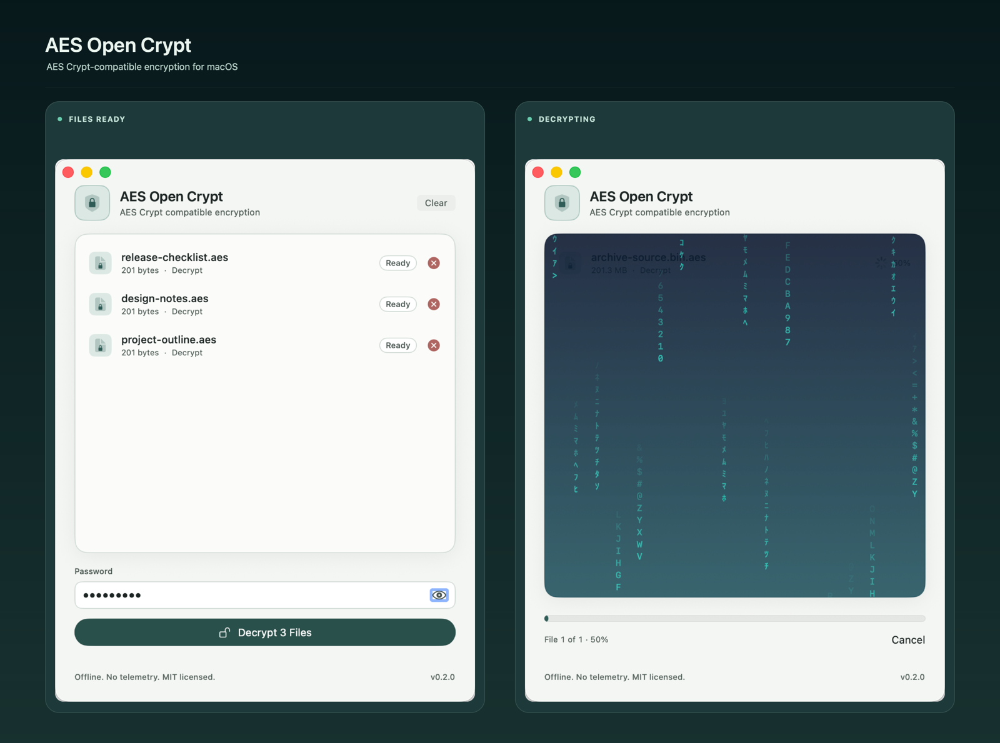

<p align="center">
  
</p>

# AES Open Crypt

<p align="center">
  
</p>

AES Crypt-compatible file encryption for macOS—no cloud, no drama, and no
password sticky notes. The app and CLI read stream formats 0–3 and write
format 3 by default or format 2 for older AES Crypt versions. No telemetry or
network access.

<p align="center">
  <a href="https://github.com/seriykot/aes-open-crypt/releases/tag/v0.2.0"></a>
  
  <a href="LICENSE"></a>
</p>

## 📦 Download

- [Installer (.pkg)](https://github.com/seriykot/aes-open-crypt/releases/download/v0.2.0/AES.Open.Crypt.0.2.0.pkg)
- [Portable app (.zip)](https://github.com/seriykot/aes-open-crypt/releases/download/v0.2.0/AES.Open.Crypt.0.2.0.zip)
- [SHA-256 checksums](https://github.com/seriykot/aes-open-crypt/releases/download/v0.2.0/SHA256SUMS.txt)

Supports Apple silicon and Intel. The app and CLI are ad-hoc signed; the
installer is unsigned. The release is not notarized, so Gatekeeper may warn
or block launch.

## ✨ Features

- Drag or choose up to 10 files; `.aes` files are decrypted and other files
  encrypted.
- Finder Services and the `aesopen` command-line tool are included.
- Outputs never overwrite existing files; wrong passwords and corrupt files
  leave no partial output.
- Optional password hints are stored in plaintext; never put a password in one.

## 🧪 Testing

- **AES Crypt versions:** 3.14 command-line tool and 4.7.0. Cross-checks cover
  format 2 with 3.14, and formats 2 and 3 with 4.7.0.
- **Fixtures:** 84 known-answer vectors (21 per stream format 0–3), a
  project-generated format 3 sample, and `.aes` files produced by AES Crypt
  3.14.
- **Real-world files:** encrypted and decrypted 11 local files, with exact
  matches and originals unchanged: 1 DOC, 2 DOCX, 3 PDF, 1 JPG, 1 RTF,
  2 ZIP, and 1 MP4. Private filenames and file contents are not published.
- **Unit tests:** `swift test` passes 97 tests.

## 🛠 Build

Requires Xcode 26 and Swift 6.2.

```bash
swift test
./scripts/build-app.sh
./scripts/build-pkg.sh
```

## 📄 License

MIT. Independent of AES Crypt and Packetizer.
